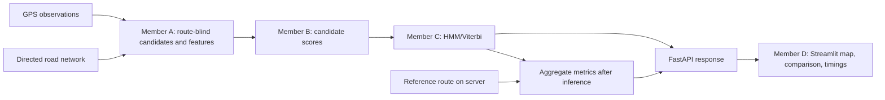

# PathSnap final report contributions and evidence plan

Use the team members' own verified experiments and interpretation to assemble one PDF. The text below documents Member D's integration and metric definitions. Do not copy synthetic decoder outputs into experimental results or insert screenshots until the application has run successfully.

## 1. System overview and architecture — Member D

PathSnap turns noisy GPS observations into a sequence of directed road arcs. Member A's parser and feature builder create route-blind candidate arcs and observation features. Member B's trained model assigns a score to each candidate. Member C's HMM/Viterbi decoder selects a connected sequence, handles missing candidates and temporal gaps, and returns segmented route geometry. FastAPI loads the model once, computes aggregate reference metrics on the server, and exposes the prediction contract. Streamlit requests the trip list and prediction from that API, then shows the GPS observations, each predicted route segment, aggregate metrics, and timings.

Reference labels are used only after inference to calculate aggregate scores. They do not enter prediction-time candidate generation, candidate scores, or frontend state. The browser-facing UI keeps an allow-listed subset of prediction response fields and drops per-observation score payloads and unknown fields.

## Member D contribution — integration, UI, and reproducibility

- Shared NumPy metrics are used by offline evaluation and the API. Added input validation and safe handling of invalid predicted arc ids in route continuity.
- The Streamlit client validates `/health` and `/predict`, distinguishes API connectivity from model readiness, reports actionable HTTP/network errors, and supports a configurable API URL for Laptop 2.
- The map draws GPS observations and every line in `predicted_lines` separately. This preserves HMM route breaks instead of joining segments across gaps. The UI can show a per-trip classifier-argmax versus HMM metric table using the API's aggregate `baseline_metrics` and `metrics`.
- The model-comparison view reads numeric rows from the actual model `experiments.csv` and Member C's actual `student_test_comparison.json`. Missing or unrecognized data is shown as unavailable; the UI does not calculate or fabricate experiment results.
- PowerShell and Bash startup scripts resolve the repository root, configure the backend/frontend, validate the dataset layout, and document one-laptop and private-LAN two-laptop runs.
- Added unit and API contract tests, a cross-platform dataset validator, startup guides, this report contribution, and a real-run screenshot checklist.

## Metrics explanation — Member D

- **Top-1 accuracy:** fraction of mapped observations whose chosen arc equals the mapped reference arc. Unmapped reference observations (`label_arc < 0`) are excluded.
- **Macro F1:** calculate F1 for each unique class present in mapped reference labels, then take the unweighted mean. Predictions for an arc absent from the reference do not add a new macro class; they still fail to match their true class.
- **Weighted F1:** the same per-class F1 values averaged by the number of reference observations for each class.
- **Candidate precision, recall, and F1:** binary candidate-row metrics at the fixed score threshold 0.5. They describe candidate scoring, not the final one-arc-per-observation accuracy.
- **Candidate log loss:** binary log loss across candidate rows, with scores clipped away from zero and one for numerical stability.
- **Candidate miss rate:** fraction of mapped observations whose reference arc was absent from the route-blind nearest candidates before any training-only positive append. In the API, candidate generation is route-blind and missing positives are not appended.
- **Route continuity:** fraction of consecutive chosen observation arcs that are the same directed arc or directly connected by an arc. Missing/invalid predictions count as disconnected; inserted HMM bridge arcs are not included in this observation-choice metric.
- **Timings:** `features_ms`, `model_ms`, `decode_ms`, `inference_ms`, and `total_ms` are measured by the API. Inference includes model scoring and decoding; total includes feature creation and response preparation.

## Dashboard explanation — Member D

The Trip reconstruction tab calls `GET /health`, `GET /trips`, and `POST /predict`. It plots observations and decoded route segments in distinct colors, identifies the decoder, and displays aggregate metrics plus feature, model, decoder, inference, and total durations when those fields are present. Missing metric values display as unavailable. A classifier-argmax/HMM table compares their actual per-trip metrics returned by the API.

The Model comparison tab reads the actual experiment CSV, B-produced model comparison CSV, and/or C-produced per-trip comparison JSON from `results/`. It plots only values present in those files. The Trip reconstruction tab exposes the model choices reported by the API and identifies which model scored the displayed result. A synthetic decoder demonstration is not treated as measured model performance.

## API and deployment — Member C API / Member D UI and setup

The API provides health and trip-list endpoints plus a validated `POST /predict`. It uses explicit readiness and error responses (404 unknown trip, 422 invalid request, 503 missing model/data, 500 unexpected server failure). `PATHSNAP_MODEL`, `PATHSNAP_DATA_DIR`, and `PATHSNAP_CORS` configure the backend. The API binds to `0.0.0.0` for two-laptop use; expose it only to a trusted private network and restrict firewall port 8000 to the UI laptop. The Streamlit service binds to loopback by default and obtains the remote API address from `PATHSNAP_API_URL`.

Linux launch commands are in `scripts/run_api.sh`, `scripts/run_ui.sh`, and `scripts/run_all.sh`. Windows PowerShell equivalents are `scripts/setup.ps1`, `scripts/start_backend.ps1`, `scripts/start_frontend.ps1`, and `scripts/start_all.ps1`. Setup, backend, and combined launch validate the train/test directory layout and all four files for each trip; backend startup refuses a student-test split that does not contain ten trips. Windows execution and cross-laptop connectivity must be verified on the actual demo machines before claiming those runs.

## Limitations and reproducibility

- This repository revision has the HMM implementation and actual B model-comparison artifacts, but no trained model bundle. Therefore live `/predict` and Streamlit/API verification have not been performed here.
- The repository includes actual six-family model comparison tables and plots. Bayesian tuning has not been run, and dataset-backed `results/part_c/student_test_comparison.json` is absent, so the dashboard's HMM comparison view remains unavailable until C supplies that artifact.
- PowerShell scripts are not Windows-execution-tested in the current environment. Network access to Python package indexes is unavailable here; install `requirements-test.txt` inside the project virtual environment on a machine with package access.
- The C service currently emits a `metric_definitions.macro_f1` description that says the union of reference and predicted classes, while `pathsnap.metrics.classification_metrics` and the frozen contract average over reference-present classes. The UI filters this metadata and displays the numeric metric from the shared helper. Member C should correct the stale description before the final report/API handoff.
- C's `results/part_c/VERIFICATION.md` describes synthetic and contract checks only; these are not real-model evaluation results.

## Screenshots checklist

Capture these only from a successful real run:

- API `/health` response with model loaded and `/trips` listing the ten reserved trips.
- Streamlit selector and a completed trip map showing observations and each separate HMM-predicted line segment.
- Per-trip classifier-argmax versus HMM metric table and real inference timing breakdown.
- Model-comparison table/chart sourced from actual model or decoder experiment output files.
- Two-laptop API health check and successful UI prediction from Laptop 2.
- Optional API-unavailable and missing-model states to show error handling.

## Team-owned sections still required

- **Member A:** dataset/EDA interpretation and route map figures based on the generated A outputs.
- **Member B:** Bayesian search and tuned-versus-untuned results remain outstanding; the saved model-comparison artifacts are present in this branch.
- **Member C:** HMM algorithm explanation, actual baseline/HMM comparisons, and correction of the stale metric definition in API metadata.
- **Member D:** incorporate verified team sections, run the cold-start two-laptop demo, capture real screenshots, and assemble the final PDF.
