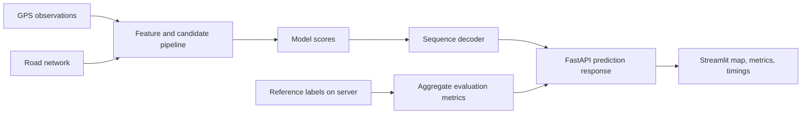

# PathSnap final report outline

Use this outline to assemble the team's single PDF. Authors should fill their sections from implementation details and generated experiment artifacts. Do not transcribe or estimate missing metrics.

## 1. Overview and system diagram — Member D

- Problem statement and project objective.
- Data-to-prediction workflow and division of responsibilities.
- State what is implemented in the submitted revision.

## 2. Data and exploratory analysis — Member A

- Dataset split, trip and observation counts from the inventory outputs.
- Feature definitions, local projection, label mapping, monotonicity, and candidate miss-rate audit.
- Include the actual generated charts and label validation findings.

## 3. Model comparison — Member B

- Compare at least five implemented models using group-aware validation.
- Report each model's actual validation and reserved student-test metrics, timing, and configuration.
- Explain the selected metrics and class definition. `macro_f1` in this code averages over reference-present arc classes; include candidate-level metrics where relevant.
- Generate the comparison table and plots from the experiment output files. The plots are written by
  `python scripts/make_figures.py` into `results/figures/`; every value is read from
  `results/model_runs.csv` or recomputed by scoring the saved artifacts on the frozen holdout split.

## 4. Bayesian hyperparameter search — Member B

- Search space, objective, trial count, seed, best parameters, and actual tuned-versus-untuned results.
- Include the saved study/trial output or a reproducible export.

## 5. HMM/Viterbi decoder — Member C

- State construction, emissions, transition constraints, handling of gaps/disconnections, and fallback behavior.
- Compare classifier-only output with HMM/Viterbi on actual evaluation runs.

## 6. Route visualisation — Member A

- Explain the Folium map layers and the role of the reference route in offline report maps.
- Include real map figures with a legend and identify the trip used.

## 7. API, UI, and deployment — Members C and D

- API endpoints and the frozen JSON contract.
- Streamlit request flow, error handling, metrics, timings, and geospatial display.
- Two-laptop setup, network configuration, startup commands, and cold-start demonstration evidence.
- State explicitly that the frontend receives predictions and aggregate metrics, not reference labels or reference geometry.

## 8. Limitations and reproducibility — all

- Known gaps and their effect on conclusions.
- Data/config/model artifact locations, software versions, seeds, exact run commands, and output files.
- Separate verified results from planned or unavailable work.

## Figure and evidence checklist

- Dataset inventory and feature/label diagnostics.
- Actual multi-model comparison chart and summary table (`results/figures/family_comparison.png`,
  `accuracy_vs_cost.png`, `per_trip_heatmap.png`; table in `results/model_comparison.md`).
- Calibration and error diagnostics (`calibration_champion.png`, `score_separation.png`,
  `candidate_miss_by_trip.png`, `feature_importance.png`).
- Bayesian search progress and tuned comparison.
- Classifier-only versus HMM route map or metric comparison.
- Streamlit screenshot with GPS observations, predicted route, real aggregate metrics, and timings.
- Two-laptop API health/trip-list evidence and successful UI request.

## Current checkout evidence status

At the time this outline was added, the repository has inventory CSV/JSON files but no `results/experiments.csv`, trained model bundle, HMM/Viterbi code, Bayesian search outputs, or screenshots. Populate these sections only after the responsible work is delivered and verified.
